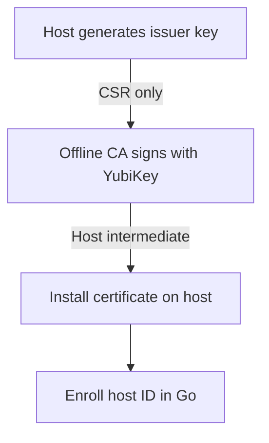
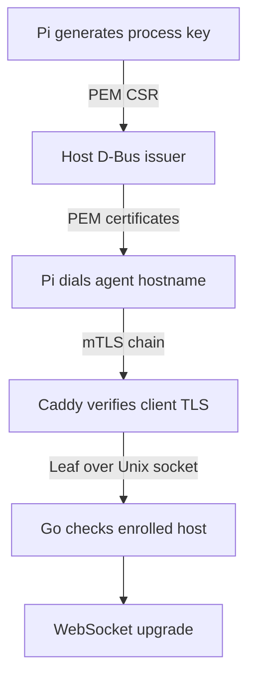
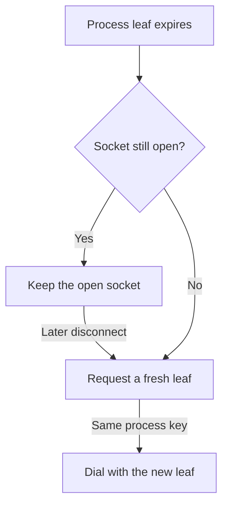
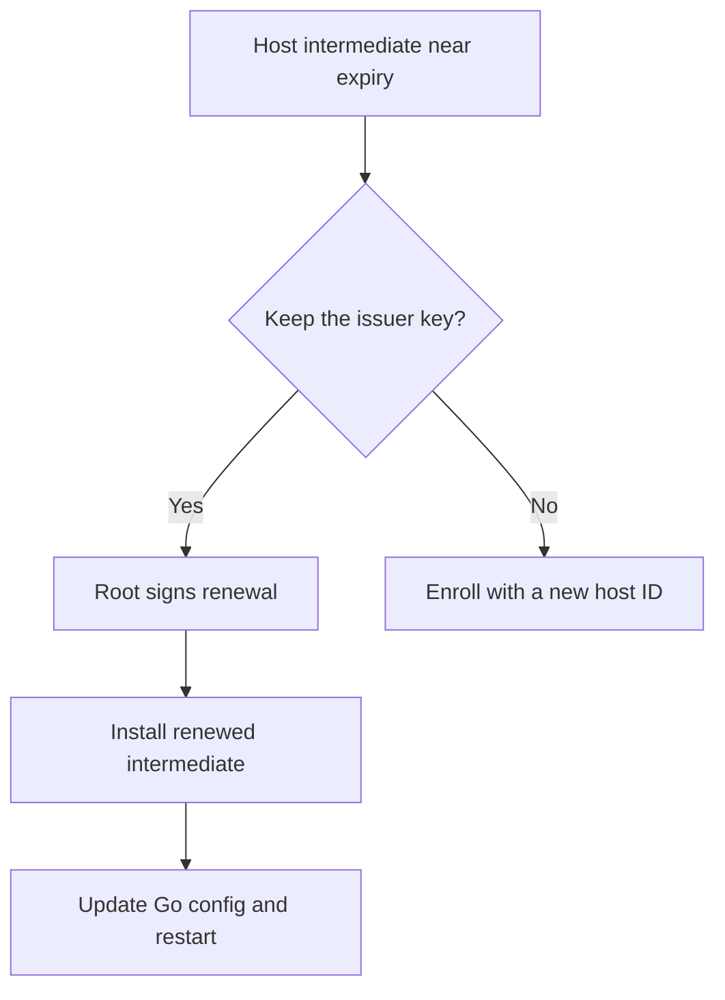
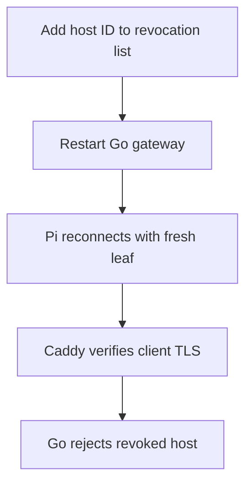

# Pi Remote agent mTLS plan

This document records the design. For deployment, enrollment, and revocation commands, see the [operator runbook](agent-mtls-operations.md). This is a coordinated replacement of bearer auth on `/agent/ws`, not a dual-auth migration. Browser auth remains with Authelia; controller bots are out of scope.

## Deployment baseline

Before this change, the `linode-server` checkout used the following deployment layout:

- `caddy/caddy/Caddyfile:40`: `pi.s.ihavenojob.work` currently sends `/agent/ws` directly to `pi-remote-server:3000` and puts the other routes behind Authelia.
- `compose.yml:42,355`: stock `caddy:2` owns ports 80/443; the Pi Remote container has no published port, shares the general `caddy` network, and reads `/run/secrets/agents.json`.
- `caddy/caddy/Caddyfile:2` and `alloy/config/config.alloy:370`: Caddy's admin API binds `:2019` and Alloy scrapes metrics there. The admin API must not remain reachable on the shared network once Caddy is trusted to assert agent identities.

## Target routing

| Public endpoint | Caddy | Gateway upstream |
| --- | --- | --- |
| `https://pi.s.ihavenojob.work` | Keep existing Authelia forward-auth for browser pages and `/ws`; return 404 for `/agent/ws` | Existing `pi-remote-server:3000`, browser-only |
| `wss://pi-agent.s.ihavenojob.work/agent/ws` | Require and verify client certificates against the dedicated Pi Remote root; return 404 for every other path | Agent-only Unix socket |

Use the existing public `:443`; no passthrough plugin, additional public port, or second TLS server in Go. Add the agent DNS record and let Caddy obtain its normal public server certificate. The Pi Remote trust root is for **client** authentication, not for validating Caddy's public server certificate. Keep strict SNI/HTTP Host matching enabled so the browser TLS policy cannot be used to reach the agent vhost.

Use `tls { client_auth { ... } }` with `mode require_and_verify` and `trust_pool file` pointing to the public root PEM. On the exact agent route, use `header_up` to **replace** (not append to) `X-Pi-Remote-Client-Cert` with `{http.request.tls.client.certificate_der_base64}`. This placeholder returns the authenticated **leaf**, not the verified intermediate. Do not forward or trust a name or claimed issuer fingerprint from the client. Exclude the certificate header from logs.

A Unix socket is a good fit here: the existing TCP network includes unrelated containers, and knowledge of a leaf certificate is deliberately not treated as proof of private-key possession by Go. Share a dedicated socket directory only between Caddy and Pi Remote, with write access for the gateway and a read-only mount for Caddy. Set directory/socket ownership and modes for the actual rootless container UIDs and verify Caddy can connect. Do not add an agent HTTP listener on the shared bridge. If a socket proves impractical, use TCP only if the agent listener is bound to an interface on a dedicated Caddy–gateway network and is unreachable from the browser/shared network; a second port bound to all interfaces is not equivalent.

Before enabling the forwarded-certificate route, bind the Caddy admin API to `localhost:2019` inside its container. Preserve `docker compose exec caddy caddy reload`; move the Alloy scrape to a separate metrics-only listener (e.g. `caddy:2020/metrics`, not published on the host). Verify the reload command and that Alloy can still scrape metrics but cannot reach the admin API.

## CA hierarchy and host identity

1. An offline YubiKey-backed Pi Remote root signs one **direct host intermediate** per enrollment (`CA:TRUE`, `pathLen=0`, certificate-signing usage). Generate the intermediate key on the host; never move it off the host or mount it into Pi. Share only public CA certificates with Caddy and Go.
2. Operator configuration in Go maps a permanent `host_id` to the enrolled intermediate certificate/public key. The configured intermediate must validate directly to the root. Display names need not be unique. Renewing an intermediate with the same key keeps the host ID and requires updating the configured certificate before expiry. A new issuer key gets a new host ID. Preserve retired IDs in the enrollment records; never reassign one.
3. The host issues non-CA client-auth leaves, valid up to 24 hours and no longer than the intermediate. The Pi process presents its leaf and host intermediate to Caddy. It has no persistent process credential or certificate identity, and its signed subject does not grant authority.
4. On the agent socket, Go validates the forwarded leaf for client auth under the configured root and enrolled intermediates. Require a verified chain with exactly one enrolled intermediate between leaf and root; fail closed if no unique enrolled issuer matches. Derive the registration's `host_id` from that intermediate, not the leaf's subject, an HTTP header containing a host name, or Pi's registration frame. Caddy has already verified possession of the leaf key; Go's chain check identifies and authorizes the host.
5. Keep a revocation list of host IDs in startup configuration. Reject revoked hosts before upgrading, even if they have just minted a new leaf. No hot reload and no dedicated live-socket revocation mechanism. Config edits take effect on an explicit gateway restart, which necessarily drops existing sockets. Leave retired IDs recorded when removing old enrollments.

## Pi host and extension

- Add a narrow host D-Bus method `IssueClientCertificate(csrPEM: s) → (leafPEM: s, intermediatePEM: s)`. Use PEM text in D-Bus strings so requests and replies are readable in debugging tools: one `CERTIFICATE REQUEST` block in, one `CERTIFICATE` block in each output. No private key crosses D-Bus. Any caller that can reach the method may enroll in v1; there is no extra caller enrollment policy. In particular, code in the Pi sandbox can get another leaf for this host. Bound the input size, reject extra PEM blocks and non-whitespace trailing data, verify the CSR signature, and build the fixed client profile on the host; ignore CSR requests for names, privileges, and extensions. Never expose a raw signing API or use SSH keys.
- The NixOS Pi wrapper already uses a filtered session bus (`home/pi-coding-agent/pineapplehunter/wrapper/wrapping.py`) with specific method allowances. Add only the new method to that proxy; package the issuer alongside existing host services. Keep host key material out of all sandbox binds, including the mounted Pi config directory. Do not broaden access to the session bus as a shortcut.
- Generate a new in-memory key pair per Pi process. Before **each** dial to the agent hostname, create a CSR with that key and request a fresh leaf via D-Bus. There is no cert cache or failed connection probe. Present the leaf plus intermediate in `wss`; keep ordinary TLS server/hostname verification enabled. Use the existing reconnect backoff for issuance or connection failures. An open socket needs no issuance timer.
- Replace the token setup UI/config with agent endpoint setup and actionable D-Bus/TLS errors. The server, not the extension, supplies authenticated host identity. Remove bearer handling, the token file and example, token redaction wiring specific to the removed credential, and legacy docs/fixtures. Do not load or send old tokens or silently use an insecure development path.

## Certificate lifecycle diagrams

### 1. Enroll a host with the offline YubiKey root

The host sends only its intermediate CSR to the offline CA. The operator installs the returned intermediate on the host and records its public certificate under a new `host_id` in Go. The host private key stays on the host. Caddy gets the public root certificate, not the host key.

### 2. Start a Pi process and connect

The Pi process generates an in-memory key and sends its CSR as PEM over D-Bus. The issuer returns the leaf and intermediate as PEM. Pi presents that chain to Caddy; Caddy verifies key possession, then forwards only the leaf to Go over the private socket. Go binds the connection to the enrolled host ID.

### 3. Reconnect after a process certificate expires

Expiry alone does not close an open WebSocket. On every new dial, even if the last leaf is still valid, Pi requests a fresh leaf with the **same process key**. If issuance or connection fails, Pi uses reconnect backoff. A new Pi process starts at step 2 with a new key.

### 4. Renew an expiring host intermediate

Renew before expiry. If the intermediate has already expired, the host cannot issue an acceptable new leaf until renewal. The same issuer key keeps the host ID; changing keys requires a new enrollment and a new ID. Caddy keeps trusting the same root.

### 5. Revoke a host

Updating the file alone leaves the running gateway unchanged. The explicit restart drops existing sockets and loads the revocation list. Caddy can still validate a revoked host's certificate chain, but Go rejects the host before WebSocket upgrade, even with a newly issued leaf.

## Implementation and cutover

1. In `pi-remote-server`, split the Go browser and agent HTTP handlers/listeners, sharing the same in-memory registry. Implement certificate-chain authorization and startup-only revocation configuration. Update the extension, protocol docs, development Compose example, and tests.
2. In `nixos-config`, package the host issuer and wire the D-Bus integration. Enroll a test host with the offline root and prove that the sandbox can get a leaf but cannot read the host key.
3. In `linode-server`, update `compose.yml`, `caddy/caddy/Caddyfile`, `alloy/config/config.alloy`, and deployment docs. Mount the public root and enrollment files read-only, and create the private agent socket mount. Remove `PI_REMOTE_TOKEN_FILE` and obsolete `agents.json` extraction from `extract.sh` and its duplicate `extract` (retire the SOPS entry separately after cutover; don't print decrypted values).
4. Validate via the actual Caddy path in staging or in an isolated Compose test. Then coordinate agent DNS, Caddy config, pinned gateway release, and updated Pi extension. Remove the browser vhost bypass before exposing the new agent route. Expect a brief disconnect and reconnect at cutover; never leave bearer auth running alongside mTLS.

### Acceptance checks

- Browser login and `/ws` keep working through Authelia; `/agent/ws` on the browser host and non-agent paths on the agent host are rejected. TLS SNI/HTTP Host mismatch is rejected.
- A valid Pi client connects and is registered under its enrolled host. No client cert, a foreign CA, an untrusted intermediate, an expired/wrong-usage leaf, or an unenrolled host cannot register. Changing the leaf subject or trying to supply an HTTP certificate/host identity header cannot change the host binding or bypass Caddy.
- From another container on the shared `caddy` network, the agent upstream and Caddy admin API are unreachable. Alloy can still scrape and the in-container Caddy reload works.
- A reconnect requests a fresh leaf using the same process key; a new Pi process generates a different key. Neither Pi process can read the host key. Revoking a host and restarting blocks new connections from that host, including with fresh leaves; other enrolled hosts can reconnect.
- A legacy bearer token is never accepted. The server fails closed if required trust/enrollment config or its agent listener is unavailable.
