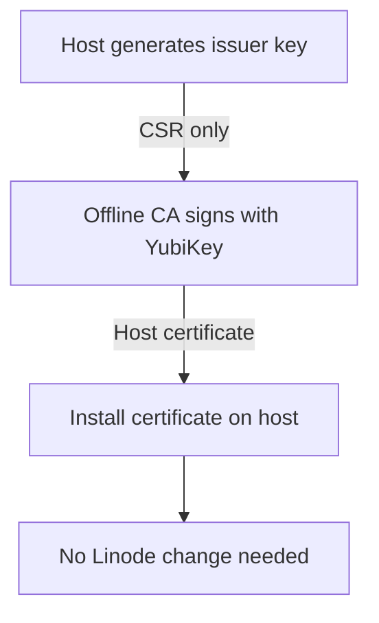
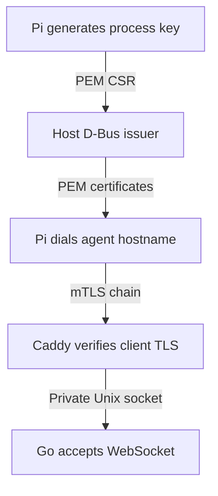
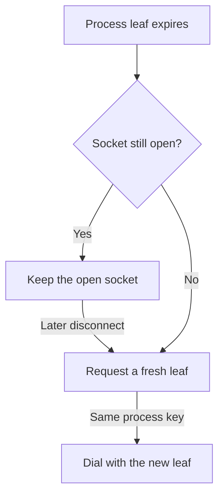
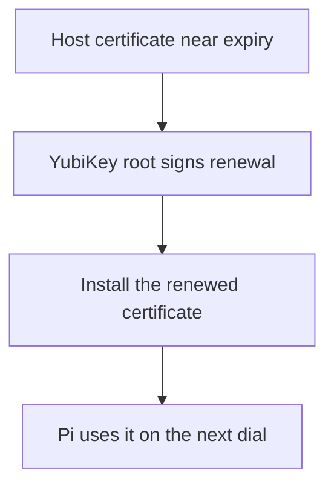

# Pi Remote agent mTLS design

See the [operator runbook](agent-mtls-operations.md) for setup and certificate commands. Caddy is the only component that authenticates agent connections. Browser login stays with Authelia, and there is no bearer-token fallback.

## Routing and trust

| Public endpoint | Caddy | Go upstream |
| --- | --- | --- |
| `https://pi.s.ihavenojob.work` | Authelia for browser pages and `/ws`; 404 for `/agent/ws` | Existing `pi-remote-server:3000`, browser-only |
| `wss://pi-agent.s.ihavenojob.work/agent/ws` | Validate client certificates against the dedicated Pi Remote root; 404 for other paths | Agent-only Unix socket |

Both hostnames use the current `:443`. Caddy obtains its normal public server certificate; the private Pi Remote root is only for client authentication. Keep strict TLS SNI/HTTP Host matching enabled. On the agent hostname, use `client_auth` with `mode require_and_verify` and `trust_pool file /run/pi-remote/root.pem`. A client that presents a valid chain to that root can connect. There is no additional host allowlist.

Caddy overwrites `X-Pi-Remote-Host` with `{http.request.tls.client.issuer}`. Go uses this as a display label (`host_id` in browser events), not as an authorization check. Caddy does not forward client certificates and Go does not read any trust files. Authorizing a computer means signing its host certificate with the dedicated root, not editing server configuration.

The Unix socket in the `pi-remote-agent` volume is the trust boundary: Caddy and Go are the only containers with the volume mounted, the socket is `0600`, and the browser listener never serves the agent endpoint. Never publish the agent listener over TCP. Caddy’s admin API is loopback-only; Alloy scrapes metrics on `caddy:2020/metrics` instead.

**Selective revocation is deferred.** Stock Caddy’s built-in client-auth verifier can match allowed leaves, but does not supply a host-intermediate revocation list for this setup. If a host signing key is compromised, it can mint client certificates until its intermediate expires. Replacing the trusted root and reissuing only to the remaining hosts is the emergency option.

## Pi host and extension

- An offline YubiKey root signs each computer’s `pathLen=0` intermediate. The computer’s signing key stays outside the sandbox. Keep the host certificate’s subject recognizable in the UI.
- A Pi process makes its own in-memory key and uses `IssueClientCertificate(csrPEM: s) → (leafPEM: s, intermediatePEM: s)` before each dial. The filtered D-Bus proxy exposes only that method. Anyone able to call it can enroll as that host; the issuer validates the CSR and fixes the leaf profile instead of signing arbitrary data. No private key crosses D-Bus.
- A client leaf lasts at most 24 hours and never past the intermediate. There is no certificate cache or renewal timer. The extension keeps its process key for reconnects and verifies Caddy’s public server certificate as usual.

## Certificate lifecycle diagrams

### 1. Sign a new computer’s certificate

### 2. Start Pi and connect

### 3. Reconnect after a temporary certificate expires

Pi requests a fresh certificate before every dial, even if the last certificate is still valid. A new Pi process starts with a new key. Failed attempts use reconnect backoff.

### 4. Renew a computer’s certificate

If the host certificate is already expired, Pi cannot get a usable certificate until renewal. Caddy still trusts the same root; there is nothing to change on Linode.

## Acceptance checks

- Browser login and `/ws` still go through Authelia. The browser hostname never serves `/agent/ws`. The agent hostname serves only `/agent/ws` and enforces TLS SNI/HTTP Host matching.
- Caddy rejects clients with no certificate or a chain to another root. A new host under the configured root can connect without changing Go or Caddy config. Caddy replaces any client-supplied host label.
- The agent socket and the Caddy admin API are not accessible from the shared Docker network. The Go application starts without CA files, an allowlist, or a revocation list. If the private socket cannot start, the gateway fails rather than opening a TCP fallback.
